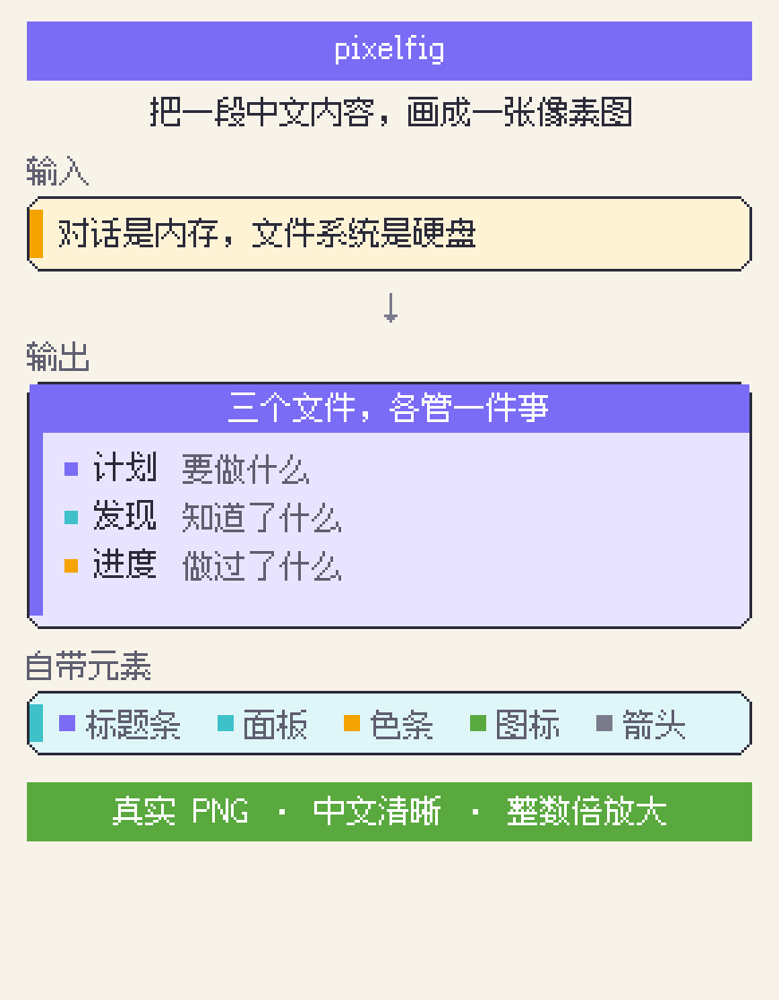

# Agent skills

我自己在用的 agent skills。遵循通用的 [Agent Skills 规范](https://agentskills.io/specification)，Claude Code、Codex、Cursor 等通用。

官网：https://dongliang.github.io/skills/

```bash
npx skills@latest add dongliang/skills
```

| 技能 | 说明 |
|---|---|
| [pixelfig](skills/visual/pixelfig/) | 把一段中文内容画成像素图，输出真实 PNG |
| [bilibili-transcript](skills/media/bilibili-transcript/) | 提取 B 站视频的文字稿、字幕、AI 总结 |

## 关于 pixelfig



输出真实 PNG 文件，不走 SVG（很多聊天界面不渲染内联 SVG）。中文用像素字体渲染，小字不糊。

需要 [Python 3](https://www.python.org/) + [Pillow](https://python-pillow.org/)。字体单独下：

```bash
sh skills/visual/pixelfig/scripts/install-fonts.sh
```

字体来自 [Fusion Pixel Font](https://github.com/TakWolf/fusion-pixel-font) 与 [Cubic 11](https://github.com/ACh-K/Cubic-11)（作者 [TakWolf](https://github.com/TakWolf)、[ACh-K](https://github.com/ACh-K)），均为 OFL-1.1。

## 关于 bilibili-transcript

```bash
node src/cli.mjs "https://b23.tv/xxxxx" --plain
```

支持短链、合集分P、B 站官方 AI 总结。技能自带脚本，零 npm 依赖，装完即用。要登录（B 站字幕接口强制），扫码一次即可。也发在 [npm](https://www.npmjs.com/package/bili-transcript) 上。

## 校验

改完跑一遍，规范有必填字段，肉眼看不出来：

```bash
npx -y skills-ref validate ./skills/visual/pixelfig
```

## License

MIT
